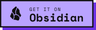
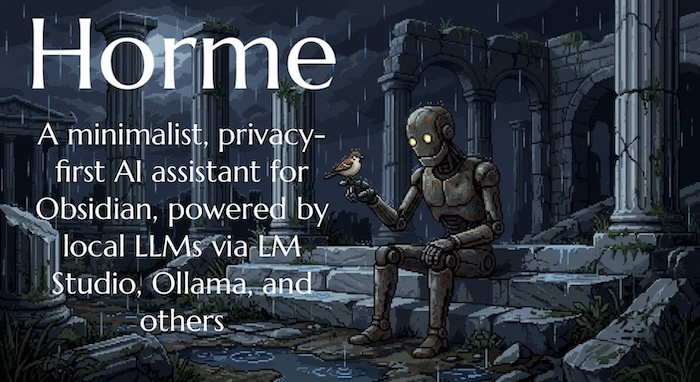
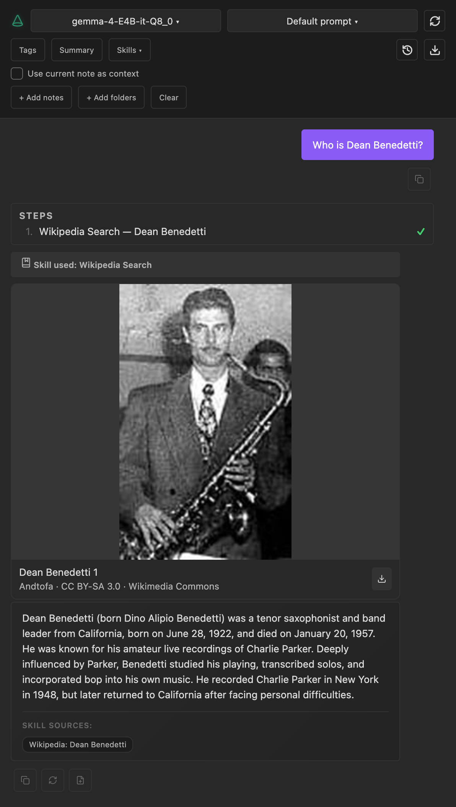
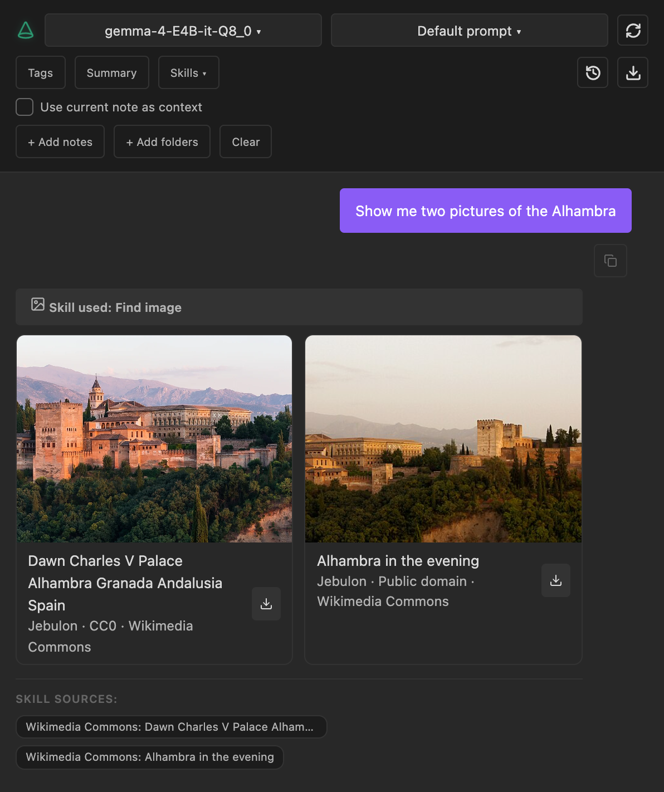

<div align="center">

# ▵ Horme

**A private AI assistant for Obsidian that runs on your own computer.**<br>
Chat with your notes, proofread and rewrite text, and search your vault by meaning.

[](https://github.com/DuckTapeKiller/horme/stargazers)
[](https://github.com/DuckTapeKiller/horme/blob/main/manifest.json)
[](https://github.com/DuckTapeKiller/horme/releases)
[](https://github.com/DuckTapeKiller/horme/issues)

<a href="https://community.obsidian.md/plugins/horme"></a>



_In Greek mythology, Horme (Ancient Greek: Ὁρμή) is the spirit of impulse and effort: setting oneself in motion and starting an action._

</div>

---

## ◈ What Horme does

- **Chat with your vault.** Ask a question and Horme finds the passages in your notes that answer it, then replies with them in view.
- **Fix and reshape text.** Select text, right-click, and proofread, rewrite, expand, summarise, translate or fact-check it. You approve every change before it replaces anything.
- **Find related notes.** A side panel shows the notes closest in meaning to the one you are reading.
- **Tag, summarise and file.** Horme suggests tags, writes a summary into a note's properties, and turns a term into a researched concept note.
- **Use tools.** Horme can look things up on Wikipedia, Wiktionary, Britannica and DuckDuckGo, show pictures (and illustrate answers with the Wikipedia article's picture), read a web page, calculate dates, consult your own grammar notes, and call any web API you set up.
- **Stay private.** With a local model, nothing leaves your computer. Cloud providers are optional, and every kind of content needs your consent before it is sent to one.

---

## ◈ Quick start with llama.cpp

Horme works with several AI providers. The recommended set-up is **[llama.cpp](https://github.com/ggml-org/llama.cpp)**: free, fast, open source, and everything runs on your own computer.

You need two models: a **chat model**, which writes the answers, and an **embedding model**, which turns your notes into numbers so Horme can search them by meaning.

### 1 · Install llama.cpp

On a Mac with [Homebrew](https://brew.sh):

```bash
brew install llama.cpp
```

On Windows or Linux, download a ready-made build from the [llama.cpp releases page](https://github.com/ggml-org/llama.cpp/releases).

### 2 · Download the two models

Models come as single `.gguf` files. Search for these names on [Hugging Face](https://huggingface.co/models) and download the `Q8_0` file of each into one folder, for example `~/models`.

| Role      | Model                     | File size | Notes                                                                    |
| --------- | ------------------------- | --------: | ------------------------------------------------------------------------ |
| Chat      | `gemma-4-E4B-it`          |    8.0 GB | The recommended chat model. Good in many languages, and uses tools well. |
| Chat      | `gemma-4-E2B-it`          |    5.0 GB | A lighter choice for computers with less memory.                         |
| Embedding | `nomic-embed-text-v2-moe` |    512 MB | Reads notes in many languages. Needed for Vault Brain.                   |

### 3 · Start the two servers

Open a terminal and start the chat server:

```bash
llama-server -m ~/models/gemma-4-E4B-it-Q8_0.gguf --port 8130
```

In a second terminal window, start the embedding server:

```bash
llama-server -m ~/models/nomic-embed-text-v2-moe.Q8_0.gguf --embeddings --port 8131
```

Ports `8130` and `8131` are the addresses Horme expects, so nothing needs changing in its settings. Leave both windows open while you use Horme.

> [!TIP]
> To switch chat models from inside Horme, start the chat server in router mode instead. It offers every model in the folder and loads the one you pick:
>
> ```bash
> llama-server --models-dir ~/models --port 8130
> ```

### 4 · Install Horme

In Obsidian, open **Settings → Community plugins → Browse**, search for **Horme**, then choose **Install** and **Enable**.

<details>
<summary>Installing by hand instead</summary>

1. Download `main.js`, `manifest.json` and `styles.css` from the latest [release](https://github.com/DuckTapeKiller/horme/releases).
2. Create the folder `.obsidian/plugins/horme` inside your vault and put the three files in it.
3. In **Settings → Community plugins**, enable **Horme**.

</details>

### 5 · Connect Horme

1. Open **Settings → Horme → Models**. **Provider** is already **llama.cpp (local)**, and the **Connection** line turns green once both servers are running.
2. Open **Vault Brain**, turn on **Use Vault Brain**, and press **Rebuild**. Horme reads your notes once; the progress shows in the status bar. After that it keeps the index up to date as you write.

### 6 · Ask

Click the **▵** icon in the left ribbon, or run **Horme: Open chat panel** from the command palette, and ask something about your notes:

> _I want to write an essay on modern art. Which of my notes can help me?_

---

## ◈ Features

### Chat

| Feature                | What it does                                                                                                        |
| ---------------------- | ------------------------------------------------------------------------------------------------------------------- |
| **Streaming replies**  | Answers appear as they are written, rendered as Markdown. Stop a reply at any time; what arrived is kept.           |
| **Model menu**         | Switch models from the chat header.                                                                                 |
| **Vault Brain toggle** | Turn note search on or off for the conversation.                                                                    |
| **Current note**       | Send the note you are reading along with your question.                                                             |
| **+ Add notes**        | Pick up to five notes as context.                                                                                   |
| **+ Add folders**      | Send the notes in whole folders, up to a limit you set.                                                             |
| **Documents**          | Upload a `.txt` or `.md` file for one conversation.                                                                 |
| **Prompt presets**     | Keep reusable instructions as notes, such as "Constitutional law professor", and switch between them in the header. |
| **Skills menu**        | Run one skill directly with your message, such as a Wikipedia search.                                               |
| **History**            | Up to 200 conversations, most recent first. Reopen, export to a note, or delete them.                               |
| **Regenerate**         | Ask again for the latest reply.                                                                                     |

### Text actions

Select text, right-click, and open **Horme**. Every change is shown as **original and replacement** before anything is replaced, and it can be undone. If the text changes while the model works, nothing is replaced and the new version goes to the clipboard.

| Action              | What it does                                                                                                |
| ------------------- | ----------------------------------------------------------------------------------------------------------- |
| **Proofread**       | Corrects grammar, spelling and punctuation, and consults your grammar notes for text in their language.     |
| **Rewrite**         | Rewrites in a tone you pick: formal, friendly, academic, sarcastic, aggressive, or humanised.               |
| **Expand**          | Adds detail and keeps the meaning.                                                                          |
| **Summarize**       | Condenses the text to its key points.                                                                       |
| **Beautify format** | Fixes headings, lists and spacing without changing the words.                                               |
| **Fact check**      | Checks each claim against Wikipedia and gives a verdict with the source.                                    |
| **Translate**       | Translates into any language you name.                                                                      |

### Vault Brain

Vault Brain is Horme's index of your notes. It is built and searched on your computer.

- **Up to date as you write.** A note you change is indexed again a few seconds later, in the background.
- **Searches by meaning and by words.** Results from the embedding model and from keyword matches in titles, headings, tags, summaries and text are blended (reciprocal rank fusion).
- **Your highlights count.** Optionally, text you marked with `==highlights==` gets its own entry, so it is found first.
- **You choose what is indexed.** Include or leave out folders with patterns such as `Templates/**`. PDFs can be indexed through the [Text Extractor](https://github.com/scambier/obsidian-text-extractor) plugin.
- **Never mixes models.** The index records which embedding set-up built it. If the set-up changes, the index is kept but not searched until you switch back or rebuild it.

### Live connections

A side panel lists the notes closest in meaning to the one you are reading. You set how close a note must be, how many to show, and which folders to leave out. Open it with the **cable** ribbon icon or **Horme: Open connections panel**.

### Tags

- **Tag suggestions.** Horme reads the open note and proposes tags, choosing from your existing tags first. You edit the list before anything is written.
- **Bilingual tag shadowing.** While Vault Brain indexes, each tag can also be stored in a second language, so a search in either language finds the note. Your notes and tags are never changed. A **Test translation** button checks the output first.

### Writing tools

- **Grammar notes.** Point Horme at a folder of grammar and style notes. Proofreading consults them for text in their language.
- **Frontmatter summaries.** **Horme: Generate frontmatter summary** writes a one- or two-sentence summary into a property you name, in the language you choose, and asks before replacing an existing one.
- **Concept notes.** Ask in the chat for a concept note on a term; Horme researches it and creates the note from your template.
- **DOCX export.** **Horme: Convert active note to DOCX**, or the file menu, saves a Word copy of a note.

### Skills

Skills are tools the model can use while it answers. In **agent mode** it plans first and may chain several skills, shown as steps in the chat.

| Skill                    | Kind     | What it does                                                                         |
| ------------------------ | -------- | ------------------------------------------------------------------------------------ |
| Wikipedia Search         | Web      | Summaries and relevant sections, in many languages.                                  |
| Wiktionary Lookup        | Web      | Definitions, etymology and usage notes.                                              |
| Britannica Search        | Web      | The opening paragraphs of an encyclopaedia article.                                  |
| Find image               | Web      | Photos and pictures in the chat, with author and licence. See [Pictures](#pictures).  |
| DuckDuckGo Search        | Web      | The top web results for a query, with links and snippets.                            |
| Fetch and Summarise      | Web      | Reads a web page you share and summarises it.                                        |
| Deep Research            | Web      | Searches Wikipedia (articles and category lists) and the web, reads the best pages in full and hands the model the most relevant passages with numbered sources. Works with no API key; uses your embedding server to pick passages when one is set up. |
| Date & Time Calculator   | Local    | Durations between dates, days of the week, adding time, and the time in any city.    |
| Vault Linker             | Your vault | Finds notes related to the conversation.                                           |
| Grammar Scholar          | Your vault | Consults your grammar notes.                                                       |
| Create Concept Note      | Web and vault | Researches a term and writes a concept note.                                   |

The round after a skill only writes the reply from what the skill found, so a local thinking model (llama.cpp, Ollama) skips its second thinking phase there and answers sooner. **Think again after a skill**, under Skills and agent, turns that thinking back on.

**Custom skills** connect Horme to any web API. Give a URL with a `{{query}}` placeholder, such as `https://openlibrary.org/search.json?q={{query}}&limit=3`, and the part of the answer to keep, such as `docs`. API keys can be read from Obsidian's keychain with `{{secret:your-secret-id}}`, so they never sit in the settings file.

### Pictures

Horme shows pictures in the chat, each with its title, author, licence and source, and a button that saves a copy to your vault.

<p align="center">
  
  &nbsp;
  
</p>

- **Pictures in answers.** When Horme looks something up on Wikipedia, the article's picture comes with the answer, at no extra cost: ask who Dean Benedetti was and his photo appears above the reply. With **With every lookup**, Britannica, web search and deep research also bring a picture of what they looked up, fetched while the lookup runs.
- **Picture requests.** "Show me two pictures of the Alhambra" or "muéstrame tres fotos de Frida Kahlo" shows the pictures straight away, without the model, in a second or two. A message that asks for more, such as "show me the Colosseum and tell me when it was built", goes to the model as usual.
- **Sources.** Wikipedia and Wikimedia Commons, The Met, NASA and the Art Institute of Chicago need no key. Openverse, Pexels, Unsplash and Brave Search use your own keys, kept in Obsidian's keychain. Brave Search finds pictures on any website, so their licences are unknown. Horme tries the sources you switch on, in the order you set, until it has enough pictures. Your search terms go to these services; your notes never do.
- **Saving.** The download button saves a large copy (never a huge original) to the folder set in **Save pictures to**, or to Obsidian's attachments folder.

---

## ◈ Privacy

> [!IMPORTANT]
> With a local provider (llama.cpp, Ollama or LM Studio), your notes, questions and answers never leave your computer.

When you choose a cloud provider:

- **Vault Brain pauses.** Passages from your notes are sent only if you turn on **Let cloud providers read notes**, which asks you to confirm.
- **You confirm each kind of content.** The current note, picked notes, folders and uploaded documents each ask once before they are sent. Switching to another cloud provider asks again.
- **Embeddings stay local.** The index is always built by a local server.
- **API keys stay out of the settings file.** They are kept in Obsidian's keychain.
- **Web skills only visit public addresses.** They refuse local and private network addresses typed directly, such as `localhost` or `192.168.x.x`.

---

## ◈ Providers

| Provider       | Where it runs | Notes                                                                    |
| -------------- | ------------- | ------------------------------------------------------------------------ |
| **llama.cpp**  | Your computer | Recommended, and selected on a new install. Leave the model empty to use the one the server has loaded. |
| **Ollama**     | Your computer | Picks an installed chat model if none is set.                            |
| **LM Studio**  | Your computer | Uses LM Studio's local server.                                           |
| **Claude**     | Cloud         | Needs an API key from Anthropic.                                         |
| **Gemini**     | Cloud         | Needs an API key from Google.                                            |
| **OpenAI**     | Cloud         | Needs an API key from OpenAI.                                            |
| **Groq**       | Cloud         | Needs an API key from Groq.                                              |
| **OpenRouter** | Cloud         | Needs an API key from OpenRouter.                                        |
| **Mistral**    | Cloud         | Needs an API key from Mistral.                                           |

With an API key set, the model field lists the provider's own models.

---

## ◈ Settings

The settings open on a status card: the active provider with a live connection dot, the size of the Vault Brain index, and whether anything leaves your computer. Each area has its own page, and each page shows its current value, so the whole set-up is visible at a glance. Every setting can also be found with Obsidian's settings search.

| Page                 | What it holds                                                                                                                       |
| -------------------- | ----------------------------------------------------------------------------------------------------------------------------------- |
| **Models**           | The active provider and its set-up (server address, model, API key), a connection check, and every other provider on its own page. |
| **Chat**             | Temperature, longest reply, the system prompt note, prompt presets, the folder context limit and the export folder.                |
| **Vault Brain**      | Turn it on, rebuild or delete the index, cloud access to notes, the embedding model, what to index, highlights, search tuning.     |
| **Live connections** | How close a note must be, how many to show, folders to leave out, style.                                                           |
| **Tags**             | Tag suggestions (tag list note, provider, model, tag index) and bilingual tag shadowing.                                           |
| **Writing tools**    | Grammar notes, frontmatter summaries and concept notes.                                                                            |
| **Skills and agent** | Native tool calling, agent mode and its skill budget, thinking after a skill, and your custom skills.                              |
| **Images**           | Pictures in answers, direct picture requests, how many pictures, where they are saved, the picture sources and their order, keys. |
| **On mobile**        | A different provider and model for phones and tablets.                                                                             |
| **Diagnostics**      | Index health, the activity log, and debug logging.                                                                                 |

Model fields offer the models your provider reports and accept any name you type. The list is fetched only when you click into the field.

---

## ◈ Commands

| Command                                 | What it does                                          |
| --------------------------------------- | ----------------------------------------------------- |
| Horme: Open chat panel                  | Opens the chat in the right sidebar.                  |
| Horme: Open connections panel           | Opens Live connections.                               |
| Horme: Proofread, Expand, Summarize, Beautify Format, Fact check, Rewrite | Text actions on the selection. |
| Horme: Generate frontmatter summary     | Summarises the open note into a property.             |
| Horme: Suggest frontmatter tags         | Proposes tags for the open note.                      |
| Horme: Convert active note to DOCX      | Saves a Word copy in the export folder.               |

---

## ◈ Requirements

- **Obsidian 1.11.4 or later.** The settings are drawn as Obsidian's own pages from version 1.13; earlier versions show the same settings as sections you open and close.
- **A provider.** llama.cpp is recommended; see the quick start above.
- **Desktop and mobile.** On a phone or tablet, use a cloud provider or a server on your network: a phone cannot reach `127.0.0.1` on your computer. **Settings → Horme → On mobile** sets a separate provider for mobile devices.

---

## ◈ Troubleshooting

| What you see                                    | What to do                                                                                                                                      |
| ----------------------------------------------- | ----------------------------------------------------------------------------------------------------------------------------------------------- |
| The **Connection** dot is red                   | Check that `llama-server` is running and that the address in **Models** matches its port.                                                       |
| Vault Brain finds nothing                       | Check that the embedding server is running, then press **Rebuild** in **Vault Brain**.                                                          |
| "Built with another embedding set-up"           | The embedding model or server changed. Switch back, or press **Rebuild** to index your notes with the new one.                                  |
| Tags are not translated                         | Set a translation model in **Tags**, or use llama.cpp, which needs none.                                                                        |
| Anything else                                   | Open **Diagnostics**, then copy the diagnostic report with the copy button and attach it to an [issue](https://github.com/DuckTapeKiller/horme/issues). |

---

## ◈ Support

Horme is free and open source. If it is useful to you, you can support its development on [Ko-fi](https://ko-fi.com/ducktapekiller). Bugs and ideas are welcome in the [issues](https://github.com/DuckTapeKiller/horme/issues).

## ◈ Author and licence

Made by **DuckTapeKiller**. Released under the [MIT licence](LICENSE).
